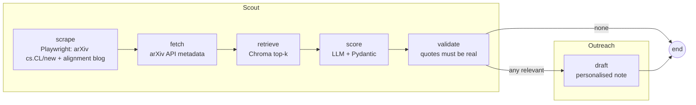

# Safety Circuits Research Agent

An autonomous LangGraph agent that tracks new arXiv papers against the open hypotheses of my
[`safety-circuits`](https://github.com/pra-nav-04/safety-circuits) research project (attention heads that cause small
instruct LLMs to refuse), pre-qualifies them with an LLM grounded in RAG over the project's own paper and findings, and
**drafts** (never sends) personalised notes to the authors of relevant ones.

## Run

```bash
uv venv --python 3.12 && uv pip install -r <(grep '"' pyproject.toml | tr -d ' ",' | grep '==')   # or: uv pip install langgraph langchain langchain-openai langchain-chroma chromadb playwright feedparser pydantic python-dotenv pytest
.venv/bin/playwright install chromium
cp .env.example .env            # fill in VLLM_API_KEY
python -m agent.run --max-papers 15      # -> runs/<timestamp>/{records.json,scores.json,drafts/*.md,digest.md}
python -m agent.run --no-validate        # optional: skip the quote check (recall 0.93 but precision 0.48, see Evaluation)
python -m pytest -q
```
Needs the research repo checked out next to this one (or `SAFETY_CIRCUITS_DIR`) as RAG source.
A committed sample is in `runs/2026-10-27_222646/` (default settings: wide prompt + validation; 30 papers, 8 flagged relevant, 8 drafts, 6 more verdicts rejected by validation). Expect false positives (here, for example, a content-moderation paper and a vision-language pricing paper passed with real quotes): measured precision is about 0.6, so the digest and drafts are for human review.

## Graph



- **scrape** (`agent/scrape.py`): Playwright loads two pages (arXiv `cs.CL/new` and the Anthropic alignment blog index); a pure `parse_listing` (tested on a saved HTML fixture) extracts entries; a keyword filter keeps likely candidates.
- **fetch** (`agent/records.py`): arXiv API gives clean records for scraped ids plus a keyword search for recent safety papers; merged by id.
- **retrieve** (`agent/rag.py`): paper + `FINDINGS.md` + `RESEARCH_PLAN.md` chunked into Chroma (default local embeddings); top-4 chunks per paper (title + abstract query).
- **score** (`agent/score.py`): structured output `{relevant, matched_hypothesis, reason}`; hypothesis is a closed set (H3, H3b, H4, F1-F3, EXT); contradictory or unparsable output becomes a recorded error, not a crash.
- **validate** (on by default; `--no-validate` skips it; `agent/score.py: validate_score`, no LLM): a relevant verdict must carry a quote that appears (fuzzy match, ratio >= 0.85) in the abstract and one in the retrieved project chunks, and else it is rejected (a self-rated `strength` gate exists but is set to 3, effectively off, because it did not help in the eval); validation is on by default. Stops invented evidence; does not prove a link is strong.
- **draft** (`agent/draft.py`): only for relevant papers; written to files.

**Why LangGraph, not a script:** explicit typed state, conditional routing (no drafting when nothing is relevant), two agent roles as sub-graphs, and a validation node slots in between score and draft without touching the rest.

**Why retrieval matters:** the scorer sees the project's own text, so a match is judged against what we actually found, not the model's guess about the topic.

## Evaluation (small, read the caveats)

`python -m agent.eval [--prompt narrow|wide]` scores two labelled sets 3 times each and compares validation variants on the same scores. **Dev**: 46 papers (`eval/papers.json`, 16 positive; AI-drafted labels, owner-reviewed, kappa AI-first-draft vs owner 0.70, narrow rubric in `eval/RUBRIC.md`). **Test**: 60 fresh papers (`eval/pool.json`, 23 positive), labelled blind by the repo owner, whose labels turned out broader than the dev rubric. CIs are bootstrap over papers; **n is small, intervals are wide**. Full tables: `eval/results_narrow.md`, `eval/results_wide.md`.

**Important caveat:** the scorer prompt was widened (`PROMPT_WIDE`) *after* seeing the test labels, to match how the owner labelled. So the "wide" test numbers are no longer a clean holdout; the "narrow" ones (original prompt, test set untouched at the time) are.

Test set, precision / recall / F1 with 95% CI:

| variant | narrow prompt (clean holdout) | wide prompt (default, post-hoc) |
|---|---|---|
| no validation (`--no-validate`) | 0.66 (0.45-0.86) / 0.61 (0.40-0.81) / 0.63 | 0.48 (0.33-0.61) / 0.93 (0.80-1.00) / 0.63 |
| validate, fuzzy quotes (**default**) | 0.62 (0.36-0.87) / 0.45 (0.24-0.68) / 0.52 | 0.61 (0.41-0.81) / 0.64 (0.43-0.83) / 0.62 |
| validate, exact quotes | 0.64 / 0.41 / 0.50 | 0.63 / 0.64 / 0.63 |
| validate + strength >= 4 | 0.62 / 0.33 / 0.43 | 0.62 / 0.54 / 0.57 |
| validate + strength >= 5 | 0.44 / 0.06 / 0.10 | 0.33 / 0.01 / 0.03 |

Dev set (narrow labels): narrow prompt no validation 0.60 / 0.88 / 0.71, fuzzy 0.61 / 0.62 / 0.62; wide prompt 0.42 / 1.00 / 0.59 and 0.44 / 0.71 / 0.54 (the wide prompt over-flags papers the narrow dev labels call not relevant).

What this says, honestly:
- **F1 is about 0.6 whichever way you configure it**; differences between variants are mostly inside the confidence intervals.
- The knobs trade precision for recall. The wide prompt without validation finds 93% of the owner's relevant papers but only 48% of what it flags is relevant; the default validated setting gives precision 0.61 / recall 0.64. The default is the validated setting (precision 0.61); `--no-validate` is the high-recall option for when you want to review more candidates. Either way every draft goes through human review (`python -m agent.review`) before anything could be sent.
- Validation's effect depends on the prompt: with the narrow prompt it lowered recall without raising precision; with the wide prompt it raised precision (0.48 -> 0.61) at a recall cost (0.93 -> 0.64). The intervals overlap, so treat that as suggestive.
- The self-rated `strength` gate never helped (kept off). A second LLM critic and a retrieval-distance guard were tried and dropped (NOTES #17, #25).
- One labeler throughout, and the owner's labels are broader than the written dev rubric (NOTES #29, `eval/RUBRIC.md`).

## Scheduling

Each run (`python -m agent.run`) is safe to schedule:
- **Health check first** (`agent/ops.py`): if the vLLM endpoint or key is unreachable it exits non-zero, logs a "skipped" line and does not mark anything as seen, so the next run retries the same papers.
- **One run at a time:** `state/run.lock` (stale after 2 h).
- **Only new papers:** `state/seen.json` (failed scorings are retried; `--no-state` rescoring everything).
- **Digest:** `runs/latest.md` (and `runs/<timestamp>/digest.md`) lists each relevant paper with matched item, both quotes, link and draft path, under a "needs human review" banner. `state/runs.log` has one JSON line per run.
- Drafts are only files; nothing is ever sent.

Install the daily 08:00 job on macOS (one command, run by you; the Mac must be awake, a missed run fires on wake):
```bash
launchctl bootstrap gui/$(id -u) deploy/com.pranav.safetyagent.plist     # remove: launchctl bootout gui/$(id -u)/com.pranav.safetyagent
launchctl kickstart -k gui/$(id -u)/com.pranav.safetyagent               # run now to test; output in state/launchd.log
```
The plist has absolute paths for this machine: edit `WorkingDirectory` and `ProgramArguments` elsewhere. Or use cron: `0 8 * * * cd /path/to/repo && .venv/bin/python -m agent.run >> state/cron.log 2>&1`.

## What broke (full log in `NOTES.md`)

- First full run printed "0 relevant" but 12/15 calls had hit a 429 quota; a catch-all in `score` hid it as "not relevant". Fix: failures carry an `error` field and are distinguishable in `scores.json`.
- The model once invented a "planned cross-lingual extension" of ours to justify a match. Prompts now say to describe the project only from supplied text. A validation node now rejects verdicts whose quotes are not in the abstract and the retrieved project text (NOTES #12); thin matches with real quotes still pass (#18), which is why drafts go through human review.

## Sales mapping

scout = lead research, score = pre-qualification, draft = personalised outreach.

The only accuracy numbers are the small labelled-set results under Evaluation; the sample run itself is unlabelled. LLM: an OpenAI-compatible vLLM endpoint. Abstracts and metadata only; nothing is sent to anyone.
