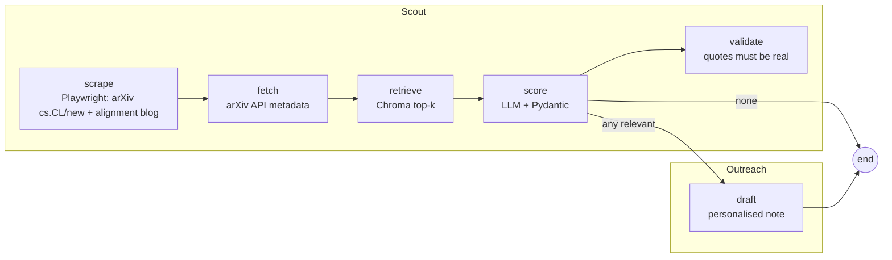

# Safety Circuits Research Agent

An autonomous LangGraph agent that tracks new arXiv papers against the open hypotheses of my
[`safety-circuits`](https://github.com/pra-nav-04/safety-circuits) research project (attention heads that cause small
instruct LLMs to refuse), pre-qualifies them with an LLM grounded in RAG over the project's own paper and findings, and
**drafts** (never sends) personalised notes to the authors of relevant ones.

## Run

```bash
uv venv --python 3.12 && uv pip install -r <(grep '"' pyproject.toml | tr -d ' ",' | grep '==')   # or: uv pip install langgraph langchain langchain-openai langchain-chroma chromadb playwright feedparser pydantic python-dotenv pytest
.venv/bin/playwright install chromium
cp .env.example .env            # fill in VLLM_API_KEY
python -m agent.run --max-papers 15      # -> runs/<date>/{records.json,scores.json,drafts/*.md}
pytest -q
```
Needs the research repo checked out next to this one (or `SAFETY_CIRCUITS_DIR`) as RAG source.
A committed sample is in `runs/2026-10-27/`.

## Graph



- **scrape** (`agent/scrape.py`): Playwright loads two pages (arXiv `cs.CL/new` and the Anthropic alignment blog index); a pure `parse_listing` (tested on a saved HTML fixture) extracts entries; a keyword filter keeps likely candidates.
- **fetch** (`agent/records.py`): arXiv API gives clean records for scraped ids plus a keyword search for recent safety papers; merged by id.
- **retrieve** (`agent/rag.py`): paper + `FINDINGS.md` + `RESEARCH_PLAN.md` chunked into Chroma (default local embeddings); top-4 chunks per paper (title + abstract query).
- **score** (`agent/score.py`): structured output `{relevant, matched_hypothesis, reason}`; hypothesis is a closed set (H3, H3b, H4, F1-F3, EXT); contradictory or unparsable output becomes a recorded error, not a crash.
- **validate** (`agent/score.py: validate_score`, no LLM): a relevant verdict must carry a quote that really appears in the abstract and one that really appears in the retrieved project chunks, else it is rejected. Stops invented evidence; does not prove a link is strong.
- **draft** (`agent/draft.py`): only for relevant papers; written to files.

**Why LangGraph, not a script:** explicit typed state, conditional routing (no drafting when nothing is relevant), two agent roles as sub-graphs, and a validation node slots in between score and draft without touching the rest.

**Why retrieval matters:** the scorer sees the project's own text, so a match is judged against what we actually found, not the model's guess about the topic.

## What broke (full log in `NOTES.md`)

- First full run printed "0 relevant" but 12/15 calls had hit a 429 quota; a catch-all in `score` hid it as "not relevant". Fix: failures carry an `error` field and are distinguishable in `scores.json`.
- The model once invented a "planned cross-lingual extension" of ours to justify a match. Prompts now say to describe the project only from supplied text. Remaining weakness (note #10): thin matches still pass; a validation node would check the reason against retrieved chunks.

## Sales mapping

scout = lead research, score = pre-qualification, draft = personalised outreach.

No accuracy numbers are claimed: the sample run is 15 papers, unlabelled. LLM: an OpenAI-compatible vLLM endpoint. Abstracts and metadata only; nothing is sent to anyone.
